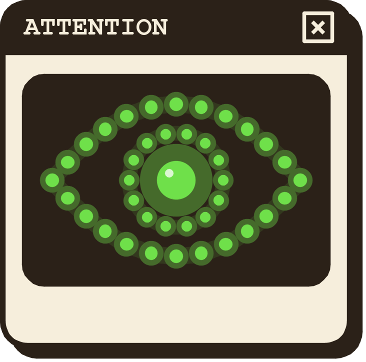

# kgnugen

Doomstop is a productivity tool that helps you stay focused by notifying you when you start doomscrolling. It can also provide virtual presenters with feedback on audience engagement, by displaying an average “attention”-score of the audience at any given moment. After a presentation, Doomstop also provides the presenter with information on how the attention progressed over time. The program transcribes the presentation, and identifies which topics resulted in lower attention scores.

## Doomstop detection productivity tool

Doomstop utilizes Logitech’s LogiInsight camera and software. To classify attention we use information about the user’s gaze, their hand positions, as well as an object detector for detecting a cellphone. We trained a logistic regression model on these features to classify the attention of different users. The model runs locally and all users are anonymous.

When it detects doomscrolling, this notification appears on the screen and a voice says "doomscroll detected":

## Doomstop for the online audience

In an online lecture or meeting, the computer in front of the audience runs the detector and sends only the attention score to the presenter: a number between 0 and 1, ten times a second. No video and no pictures leave the audience’s computer.

During the talk, the presenter sees a small LED eye in the corner of the screen. It turns from red to green as the audience’s attention rises, so there are no numbers to read while speaking.

When the talk is over, Doomstop shows a feedback card: the attention over the whole talk, the moments that gained and lost the audience, and what was being said at those moments. The words come from a transcript of the presenter’s own microphone, made on the presenter’s computer.

**On a Mac?** The LogiInsight colour camera isn't listed by macOS: use [`mac/`](mac/README.md) (Mac only).

This was created for the Lauzhack hackathon 2027 at EPFL, for Logitech’s challenge.
