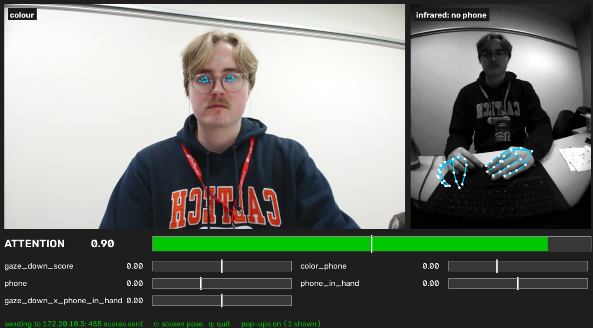
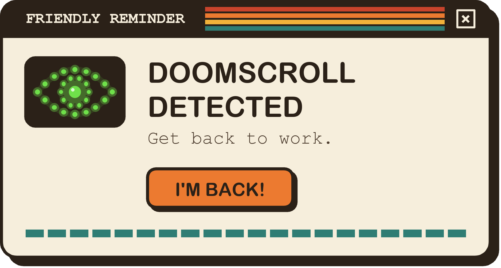

# Doomstop

Doomstop is a productivity tool that helps you stay focused by notifying you when you start doomscrolling. It can also provide virtual presenters with feedback on audience engagement, by displaying an average “attention”-score of the audience at any given moment. After a presentation, Doomstop also provides the presenter with information on how the attention progressed over time. The program transcribes the presentation, and identifies which topics resulted in lower attention scores. Doomstop was created for the Lauzhack hackathon 2027 at EPFL for Logitech’s challenge.

## Doomstop detection productivity tool

Doomstop utilizes Logitech’s LogiInsight camera and software. To classify attention we use information about the user’s gaze, their hand positions, as well as an object detector (YOLOX-S) for detecting a cellphone. We trained a logistic regression model on these features to classify the attention of different users. The model runs locally and all users are anonymous.



When it detects doomscrolling, this notification appears on the screen and a voice says "doomscroll detected":



## Audience attention data

In an online lecture or meeting, the computer in front of the audience runs the detector and sends only the attention score to the presenter. No video and no pictures leave the audience’s computer.

During the talk, the presenter sees a small LED eye in the corner of the screen. It turns from red to green as the audience’s attention rises, so there are no numbers to read while speaking.

 

Left: the audience is fully focused. Right: attention is at about half.

When the talk is over, Doomstop shows a feedback card: the attention over the whole talk, the moments that gained and lost the audience, and what was being said at those moments. This is done by first transcribing the meeting (Whisper). A small local LLM (Qwen 2.5, 3B) then analyzes the text and picks out keywords and topics for the different time intervals. The words come from a transcript of the presenter’s own microphone, made on the presenter’s computer.


<br>

## Setup

Doomstop requires the Logitech LogiInsight camera. Connect it by USB to a Windows computer and set up its network link and login as described in [`logiinsight_api/README.md`](logiinsight_api/README.md): the camera’s username and password go in the environment variables `LOGIWEBCAM_USER` and `LOGIWEBCAM_PASSWORD`. Then install the Python packages:

```
pip install -r requirements.txt
```

### Productivity tool

```
python detector/focus.py
```

This opens the dashboard, with both camera pictures, the attention score and the signals, and shows the DOOMSCROLL DETECTED notification when you start scrolling. Look at the screen for the first second, while your normal pose is measured. Press `q` in the dashboard to quit.

`python detector/dashboard.py` shows the same dashboard without the notification.

### Audience engagement

#### Presenter

Start the presenter’s side first, on a Mac, from the repository folder:

```
python3 demo.py
```

It installs the packages it needs, checks the network and the microphone, and prints the command for the listener’s computer with this computer’s address filled in. Press Enter to start: the LED eye appears and the microphone is recorded. When the talk is over, close the eye to get the feedback card. For topics written by the LLM, [Ollama](https://ollama.com) must be installed with the model `qwen2.5:3b`; without it, the topics are plain keywords. [`DEMO.md`](DEMO.md) has the details.

#### Listener

On the computer with the camera, with the presenter’s address in place of `172.20.10.3`:

```
python call/score_sender.py --to 172.20.10.3 --dashboard --popup
```

This sends the attention score to the presenter; sending starts by itself once the camera is ready. `--dashboard` and `--popup` are optional: they also show the dashboard and the notification on the listener’s own screen. Both computers must be on the same network.

## Technical details

**Features and model.** The model reads five signals, each between 0 and 1. Each signal is averaged over the last 2 seconds and over the last 6 seconds, which gives the model ten inputs. The averages are what make the score depend on time: a quick glance at the phone barely moves it, while continued scrolling does.

A logistic regression turns the ten inputs into the attention score. The last two columns of the table are its weights, per standard deviation of each input; a negative weight lowers the attention score. The bias is +1.33.

| Signal | What it measures | Weight, 2 s average | Weight, 6 s average |
|---|---|---|---|
| `gaze_down_score` | How far the upper eyelids have dropped from the person’s normal pose, measured on the face landmarks that the LogiInsight camera computes. The normal pose is measured in the first second. | −2.03 | +0.58 |
| `color_phone` | The object detector’s confidence that a phone is in the colour picture. | +0.48 | +0.05 |
| `phone` | The object detector’s confidence that a phone is in the infrared picture. | +0.38 | +0.81 |
| `phone_in_hand` | How close a hand is to that phone in the infrared picture, from hand landmarks (MediaPipe), smoothed over time. | +0.48 | +0.13 |
| `gaze_down_x_phone_in_hand` | `phone_in_hand` while the person is looking down, otherwise 0. | −1.15 | −0.77 |

**Training data.** Three people each followed ten short scripted scenarios in front of the camera: working with the phone away or on the desk, looking down at the keyboard, holding the phone while reading the screen, scrolling in three positions, quick glances at the phone, and working, scrolling, then working again. That is about 10 minutes of recording in total and 9,792 rows, one per camera frame; 9,074 of them were used for fitting.

**Performance.** The model is trained on these three people and was tested on a fourth person, who is not in the training data. In a cross-check on the recordings themselves (fitted on two of the people and scored on the third, for each person in turn), it calls attentive or distracted correctly in 75 % of moments. In the same cross-check:

- **Detecting doomscrolling.** While a person scrolls on their phone, the notification would have appeared in 7 of the 9 scrolling recordings (note that the recordings were short).
- **Not disturbing work.** While a person works at the screen, with the phone away, on the desk or in the hand, the model reads 94 % of moments as attentive. Two-second glances at the phone never triggered the notification.

**Robustness.** Note that the model does not yield false positives from simply showing your phone: for a person the model was not trained on, holding the phone while reading the screen scores 0.97 and working with the phone lying on the desk scores 0.82 (1 is fully attentive). Looking down at the keyboard with the phone on the desk scores 0.76.

Doomstop was created for the Lauzhack hackathon 2027 at EPFL for Logitech’s challenge.
