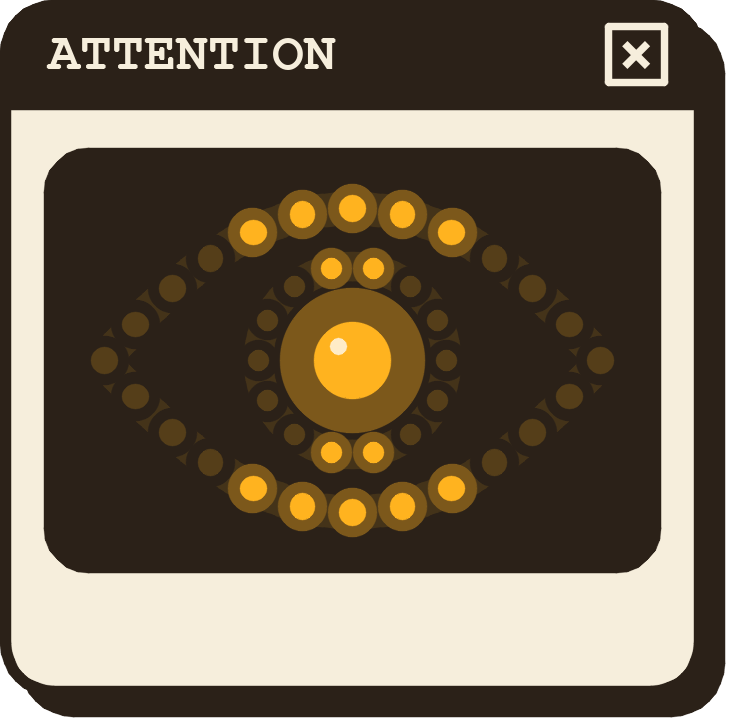
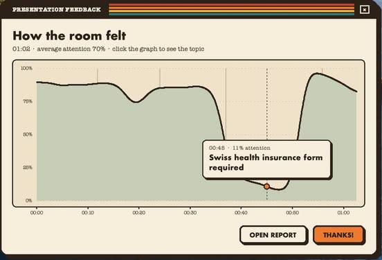

# kgnugen

Doomstop is a productivity tool that helps you stay focused by notifying you when you start doomscrolling. It can also provide virtual presenters with feedback on audience engagement, by displaying an average “attention”-score of the audience at any given moment. After a presentation, Doomstop also provides the presenter with information on how the attention progressed over time. The program transcribes the presentation, and identifies which topics resulted in lower attention scores. Doomstop was created for the Lauzhack hackathon 2027 at EPFL, for Logitech’s challenge.

## Doomstop detection productivity tool

Doomstop utilizes Logitech’s LogiInsight camera and software. To classify attention we use information about the user’s gaze, their hand positions, as well as an object detector (YOLOX-S) for detecting a cellphone. We trained a logistic regression model on these features to classify the attention of different users. The model runs locally and all users are anonymous.

When it detects doomscrolling, this notification appears on the screen and a voice says "doomscroll detected":

## Audience attention data

In an online lecture or meeting, the computer in front of the audience runs the detector and sends only the attention score to the presenter. No video and no pictures leave the audience’s computer.

During the talk, the presenter sees a small LED eye in the corner of the screen. It turns from red to green as the audience’s attention rises, so there are no numbers to read while speaking.

 

Left: the audience is fully focused. Right: attention is at about half.

When the talk is over, Doomstop shows a feedback card: the attention over the whole talk, the moments that gained and lost the audience, and what was being said at those moments. This is done by first transcribing the meeting (Whisper). A small local LLM (Qwen 2.5, 3B) then analyzes the text and picks out keywords and topics for the different time intervals. The words come from a transcript of the presenter’s own microphone, made on the presenter’s computer.

## Technical details

**Features.** The model reads five signals, each between 0 and 1:

| Signal | What it measures |
|---|---|
| `gaze_down_score` | How far the upper eyelids have dropped from the person’s normal pose, measured on the face landmarks that the LogiInsight camera computes. The normal pose is measured in the first second. |
| `color_phone` | The object detector’s confidence that a phone is in the colour picture. |
| `phone` | The object detector’s confidence that a phone is in the infrared picture. |
| `phone_in_hand` | How close a hand is to that phone in the infrared picture, from hand landmarks (MediaPipe), smoothed over time. |
| `gaze_down_x_phone_in_hand` | `phone_in_hand` while the person is looking down, otherwise 0. |

Each signal is averaged over the last 2 seconds and over the last 6 seconds, which gives the model ten inputs. The averages are what make the score depend on time: a quick glance at the phone barely moves it, while continued scrolling does.

**Model.** A logistic regression turns the ten inputs into the attention score. These are its weights, per standard deviation of each input; a negative weight lowers the attention score. The bias is +1.33.

| Signal | 2 s average | 6 s average |
|---|---|---|
| `gaze_down_score` | −2.03 | +0.58 |
| `color_phone` | +0.48 | +0.05 |
| `phone` | +0.38 | +0.81 |
| `phone_in_hand` | +0.48 | +0.13 |
| `gaze_down_x_phone_in_hand` | −1.15 | −0.77 |

**Training data.** Three people each followed ten short scripted scenarios in front of the camera: working with the phone away or on the desk, looking down at the keyboard, holding the phone while reading the screen, scrolling in three positions, quick glances at the phone, and working, scrolling, then working again. That is about 10 minutes of recording in total and 9,792 rows, one per camera frame; 9,074 of them were used for fitting. Only the signal values were recorded, no video. The target attention falls from 1 to 0 over 4 seconds of scripted distraction and recovers over 1.5 seconds.

Fitted on two of the people and tested on the third, for each person in turn, the model calls attentive or distracted correctly in 75 % of moments.

**Robustness.** It does not yield false positives from simply showing your phone: for a person the model was not trained on, holding the phone while reading the screen scores 0.97 and working with the phone lying on the desk scores 0.82 (1 is fully attentive). Looking down at the keyboard with the phone on the desk scores 0.76. Looking down at the keyboard with no phone in view is the model’s weak spot: it scores 0.37 and is still often read as distraction.

Doomstop was created for the Lauzhack hackathon 2027 at EPFL, for Logitech’s challenge.
