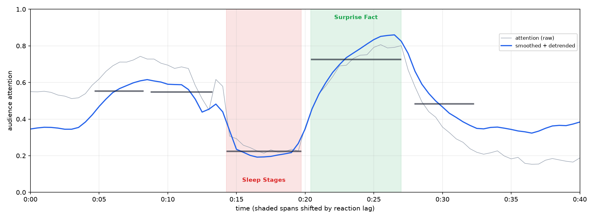

# Attention insights

Talk length 0:40 · mean attention 0.47 · 5 chunks · lag 2 s · summaries by qwen2.5:3b via Ollama

## Key insights

- High attention episodes contain surprising facts, while low attention episodes are technical and less engaging.
- Speakers should consider incorporating more surprising elements to maintain audience interest.
- Technical details should be simplified or connected to real-world applications to maintain audience engagement.

## High-attention moments

### 0:18–0:25 · Surprise Fact
attention 0.73 (z +1.34) · keywords: surprise, people, practicing, piano, wake, playing

The high attention is due to the unexpected and surprising nature of the fact about playing better without extra practice after sleep.

> But here's the surprise. People who sleep after practicing piano wake up playing better without any extra practice.

## Low-attention moments

### 0:12–0:17 · Sleep Stages
attention 0.22 (z -1.74) · keywords: stage, makes, full, cycle, roughly, minutes

The explanation for the low attention is the technical and less engaging nature of the content about sleep stages.

> Stage 2 makes up about 50 % of the night and a full cycle has roughly 90 minutes.

## All chunks

| time | attention | z | text |
|---|---|---|---|
| 0:02–0:06 | 0.55 | +0.29 | The night before my biggest exam I skipped sleep.… |
| 0:06–0:11 | 0.55 | +0.26 | The next morning my mind was completely blank. Sleep has four stages.… |
| 0:12–0:17 | 0.22 | -1.74 | Stage 2 makes up about 50 % of the night and a full cycle has roughly 90 minutes… |
| 0:18–0:25 | 0.73 | +1.34 | But here's the surprise. People who sleep after practicing piano wake up playing… |
| 0:25–0:30 | 0.48 | -0.15 | The slides will be uploaded by Friday and next week's room is building C.… |
